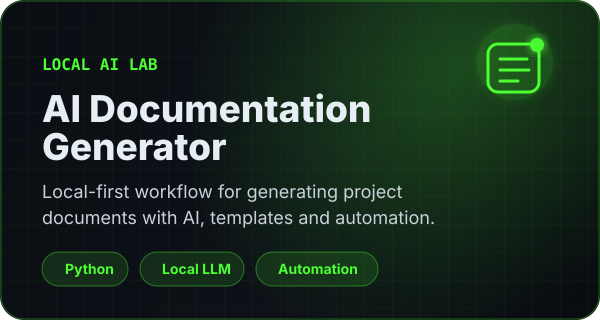

<td width="50%" valign="top">
  

  <h3>📄 About the project</h3>

  

    A local-first AI documentation lab designed to generate project management documents using local models, structured prompts, templates and automation workflows.
  

  

    <strong>Stack:</strong> Python, Local LLMs, Prompt Engineering, Automation
  

  

    <strong>Focus:</strong> Project documentation, privacy-first workflows, process automation and AI-assisted productivity.
  

  
</td>